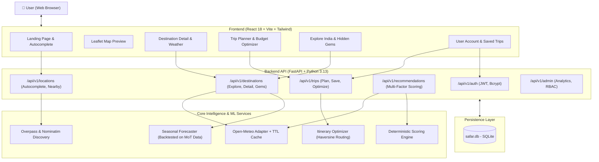

# S.A.F.A.R. (Smart AI-driven Framework for Advanced Route & Tourism Optimization)

> **An Intelligent, Data-Grounded Tourism Planning, Seasonal Demand Forecasting & Itinerary Optimization Platform for India.**

---

## 1. Executive Summary & Vision

**S.A.F.A.R.** is a modern, enterprise-grade travel intelligence platform engineered to replace generic static tourism portals with a coherent, mathematically grounded, and real-time capable travel planning engine. 

Unlike conventional travel aggregators that fabricate itineraries or rely on unverified LLM hallucinations, S.A.F.A.R. strictly combines:
1. **Deterministic Geospatial Routing & Clustering** using genuine geographic coordinates and Haversine transit formulations.
2. **Empirical Seasonal Demand Forecasting** validated via backtesting against official Ministry of Tourism (Govt. of India) arrival statistics.
3. **Live Meteorological Observations** through an open WMO-compliant weather provider adapter.
4. **Transparent, Itemized Budget Arithmetic** that models travel style multipliers, accommodation tiers, and contingency buffers without inventing fake live prices.
5. **Real-Time Place Discovery** via OpenStreetMap Nominatim geocoding and Overpass API query integration.

---

## 2. Complete Technology Stack

### Backend Architecture
- **Framework:** [FastAPI](https://fastapi.tiangolo.com/) (Python 3.13) — High performance, asynchronous REST API with automatic OpenAPI (Swagger) documentation.
- **Database & ORM:** [SQLite](https://www.sqlite.org/) with [SQLAlchemy 2.0](https://www.sqlalchemy.org/) — Relational data modeling, thread-safe session management, and automated schema migration helpers.
- **Authentication & Security:** JWT (JSON Web Tokens) with `HS256`, password hashing via `bcrypt` / `passlib`, and Role-Based Access Control (`USER` and `ADMIN`).
- **Data Validation & Serializers:** [Pydantic v2](https://docs.pydantic.dev/) — Strict runtime input validation, schema enforcement, and typing.
- **Scientific Computing & Analytics:** `pandas`, `numpy`, and `scikit-learn` for time-series backtesting, train/test holdout split evaluations (MAE, MAPE), and spatial clustering.
- **External Provider Integrations:**
  - **Nominatim (OpenStreetMap):** Forward geocoding, boundary resolution, and location autocomplete.
  - **Overpass API (OSM):** Real-time bounding/radius discovery of attractions, temples, viewpoints, parks, restaurants, and accommodation.
  - **Open-Meteo API:** WMO-standard live weather observation adapter with in-memory thread-safe TTL caching (30-minute retention) and offline fallback.
- **Test Framework:** [pytest](https://docs.pytest.org/) & `httpx` / FastAPI `TestClient` — 30 automated test suites covering end-to-end functionality.

### Frontend Architecture
- **Core Library:** [React 18](https://react.dev/) with [TypeScript](https://www.typescriptlang.org/) for strict static typing.
- **Build Tooling:** [Vite 5](https://vitejs.dev/) — Lightning-fast HMR and optimized production rollup builds.
- **Styling & UI Components:** [Tailwind CSS](https://tailwindcss.com/) with custom dark-mode aesthetic (slate/amber accents) and [Lucide React](https://lucide.dev/) icons.
- **Interactive Geospatial Maps:** [Leaflet](https://leafletjs.com/) and [React-Leaflet](https://react-leaflet.js.org/) — Dynamic interactive maps, custom SVG markers, boundary circles, and responsive fitBounds.
- **Data Visualizations:** [Recharts](https://recharts.org/) — Responsive seasonal tourism demand charts displaying projected footfalls, crowd thresholds, and backtesting metrics.
- **HTTP Client:** [Axios](https://axios-http.com/) configured with interceptors for automatic JWT bearer authentication.

---

## 3. High-Level Architecture Diagram



---

## 4. Key Modules & Functional Capabilities

### A. Real Location Discovery & Autocomplete
- **Dynamic Geocoding:** Converts any Indian city, town, or landmark (e.g. *Vijayawada*, *Araku Valley*, *Hyderabad*, *Jaipur*) to verified latitude/longitude coordinates via Nominatim.
- **Configurable Radius:** Discovers points of interest within 5 km to 100 km.
- **Category Chips:** Filters by Temples, Historical Monuments, Viewpoints, Parks, Museums, Food, and Stays.
- **Spatial Separation:** Strictly prevents city search contamination—searching Vijayawada never returns distant North Indian spots.

### B. Data-Grounded Demand Forecasting
- **Authentic Data Foundation:** Grounded in documented statistical records from the Ministry of Tourism (Govt. of India) and State Tourism Boards.
- **Time-Split Backtesting:** Evaluates predictive accuracy using chronological train/test holdout splits, reporting MAE and MAPE.
- **Transparency Flags:** Displays `data_source`, `forecast_period`, `limitations`, and flags forecasts as `is_experimental: True` when historical observations are sparse (<6 observations).

### C. Deterministic Recommendations & Explainability
- **Mathematical Weights:**
  - 30% User Interest Overlap
  - 25% Budget Fit
  - 20% Crowd Fit
  - 15% Transit Feasibility (penalizes trips where transit consumes >40% of daytime)
  - 10% Seasonality Match (checks destination `best_months`)
- **Explainable Rationale:** Every recommendation card provides 4–5 verifiable bullet points explaining the exact mathematical basis of its recommendation.

### D. Intelligent Trip Planner & Budget Optimizer
- **Transparent Budget Separation:** Disaggregates total estimated trip cost into:
  - Transport (Inter-city round trip based on distance and mode)
  - Accommodation (Tier-based: Budget, 3-Star, 4/5-Star)
  - Food & Dining
  - Attraction Entry Fees
  - Activities & Experiences
  - Local Commute & Transit
  - Contingency Buffer (10%)
- **Day-Wise Geographic Clustering:** Groups proximate attractions onto the same calendar day, avoiding unrealistic hops across town.
- **Dynamic Stop Editing:** Users can add, delete, or reorder itinerary stops; transit times and budgets automatically recalculate.

### E. Explore India & Hidden Gems Catalog
- **Explore India:** Nationwide catalog supporting state-level, regional, and interest-based exploration across India.
- **Hidden Gems:** Curated offbeat destinations labeled with verifiable selection methods (`SCENIC_OFFBEAT`, `VERIFIED_HERITAGE`, `CURATED_LOW_CROWD`) to ensure authentic discovery without misleading popularity claims.

### F. Authentication, Security & Account Management
- **Security:** Passwords hashed with `bcrypt`, stateless JWT bearer tokens with configurable expiry.
- **User Dashboard:** View upcoming, saved, and completed trips; update trip status; edit budgets; or delete trips.
- **Data Isolation:** Enforces strict user ownership checks—users can only access and modify their own trips.
- **Admin RBAC:** Dedicated `/api/v1/admin/analytics` and administrative endpoints protected by role verification (`role == 'ADMIN'`).

---

## 5. Project Directory Structure

```text
safar_prototype/
│
├── README.md                           # This all-in-one comprehensive document
├── safar.db                            # Root SQLite database instance
│
├── backend/                            # FastAPI Backend Application
│   ├── app/
│   │   ├── api/                        # API route handlers
│   │   │   ├── admin.py                # Admin analytics & management
│   │   │   ├── auth.py                 # Register, login, current-user profile
│   │   │   ├── destinations.py         # Destinations, explore-india, hidden gems
│   │   │   ├── locations.py            # Autocomplete & Overpass nearby discovery
│   │   │   ├── recommendations.py      # Personalized getaway recommendations
│   │   │   └── trips.py                # Plan preview, save, edit, recalculate
│   │   ├── core/                       # Configurations & security tokens
│   │   │   ├── config.py               # Application settings & database URLs
│   │   │   └── security.py             # Bcrypt hashing & JWT handling
│   │   ├── db/                         # SQLAlchemy session and models
│   │   │   ├── models.py               # ORM schemas (Users, Trips, Destinations, etc.)
│   │   │   └── session.py              # Engine creation & sessionmaker
│   │   ├── ml/                         # Scientific & deterministic algorithms
│   │   │   ├── forecaster.py           # Demand forecasting & backtesting
│   │   │   ├── optimizer.py            # Geographic clustering & day-wise planning
│   │   │   └── recommender.py          # Multi-factor recommendation scoring
│   │   ├── schemas/                    # Pydantic v2 schemas
│   │   │   └── schemas.py              # DTOs & response contracts
│   │   ├── services/                   # External provider services
│   │   │   ├── location_service.py     # Nominatim geocoding & Overpass API adapter
│   │   │   ├── nationwide_service.py   # Explore India nationwide service
│   │   │   ├── trip_service.py         # Budget arithmetic & cost breakdown
│   │   │   └── weather_provider.py     # Open-Meteo WMO weather adapter with TTL cache
│   │   └── main.py                     # FastAPI application entrypoint & migrations
│   ├── tests/                          # Automated backend test suites
│   │   ├── test_api.py                 # Core endpoint tests
│   │   ├── test_auth_account.py        # Authentication & RBAC tests
│   │   ├── test_explore_india.py       # Explore India & Hidden Gems tests
│   │   ├── test_forecasting_recommendations.py # Forecast validation & weather tests
│   │   └── test_trip_planner.py        # Budget & itinerary recalculation tests
│   ├── e2e_journey_audit.py            # Automated 20-step complete journey script
│   ├── seed_data.py                    # Seed destinations, attractions, and test users
│   └── requirements.txt                # Python dependencies
│
└── frontend/                           # React + Vite Frontend Application
    ├── src/
    │   ├── api/
    │   │   └── client.ts               # Axios instance with auth interceptors
    │   ├── components/                 # Reusable UI components
    │   │   ├── DemandChart.tsx         # Recharts seasonal demand forecast
    │   │   ├── IndiaDestinationMap.tsx # Leaflet map for nationwide exploration
    │   │   ├── LocationMap.tsx         # Leaflet map for local nearby places
    │   │   ├── Navbar.tsx              # Top navigation bar
    │   │   └── LoadingScreen.tsx       # Polished loading state
    │   ├── pages/                      # Application view pages
    │   │   ├── LandingPage.tsx         # Main landing & trip-planning inputs
    │   │   ├── DestinationDetailPage.tsx # Destination overview, weather & attractions
    │   │   ├── RecommendationsPage.tsx # Recommendations & explainability cards
    │   │   ├── TripPlannerPage.tsx     # Day-wise itinerary & interactive budget editor
    │   │   ├── ExploreIndiaPage.tsx    # Nationwide & Hidden Gems discovery
    │   │   ├── AuthPage.tsx            # Login and Registration modals
    │   │   ├── DashboardPage.tsx       # Saved trips, status manager, user profile
    │   │   └── AdminDashboardPage.tsx  # Analytics dashboard for admins
    │   ├── types/
    │   │   └── index.ts                # TypeScript interfaces and contracts
    │   ├── App.tsx                     # Top-level state and routing
    │   ├── main.tsx                    # React DOM entry point
    │   └── index.css                   # Tailwind CSS root stylesheet
    ├── vite.config.ts                  # Vite development & proxy configuration
    ├── tsconfig.json                   # TypeScript compiler options
    └── package.json                    # Frontend dependencies and scripts
```

---

## 6. Setup, Installation & Execution Guide

### Prerequisites
- **Python:** 3.11+ (Python 3.13 tested and verified)
- **Node.js:** v18+ (Node 20+ recommended)
- **Package Manager:** `npm` or `pnpm`

### Step 1: Clone & Configure Backend
```bash
# Navigate to the backend folder
cd backend

# Create and activate a Python virtual environment (optional but recommended)
python -m venv venv
# On Windows:
venv\Scripts\activate
# On Linux/macOS:
source venv/bin/activate

# Install required dependencies
pip install -r requirements.txt

# Seed baseline Indian destinations, attractions, and default test accounts
python seed_data.py
```

### Step 2: Run Backend Automated Tests
Verify that all 30 automated test cases pass:
```bash
python -m pytest tests/ -v
```

### Step 3: Start the Backend Server
```bash
python -m uvicorn app.main:app --host 127.0.0.1 --port 8000 --reload
```
*The API will be live at `http://127.0.0.1:8000`.*  
*Interactive Swagger documentation: `http://127.0.0.1:8000/docs`.*

---

### Step 4: Configure & Start Frontend
Open a new terminal window:
```bash
# Navigate to the frontend folder
cd frontend

# Install npm dependencies
npm install

# (Optional) Verify TypeScript compilation and build production assets
npm run build

# Start the Vite development server
npm run dev
```
*The frontend application will be live at `http://localhost:5173`.*

---

## 7. Default Credentials & Test Accounts

For evaluation and testing, the database includes pre-configured test users:

| Role | Email | Password | Access Level |
|---|---|---|---|
| **Admin** | `admin@safar.ai` | `admin123` | Full access to Admin Analytics & User Metrics |
| **User** | `user@safar.ai` | `user123` | Personal Trip Planning, Saved Itineraries & Profile |
| **Guest** | *None* | *None* | Guest browsing, autocomplete, destination discovery & plan previews |

---

## 8. Verified Test Results & Reliability Metrics

S.A.F.A.R. has undergone thorough automated verification:

- **Pytest Suite:** 30 / 30 tests passed (`tests/test_api.py`, `tests/test_auth_account.py`, `tests/test_explore_india.py`, `tests/test_forecasting_recommendations.py`, `tests/test_trip_planner.py`).
- **TypeScript & Rollup Compilation:** Zero type errors (`tsc && vite build` passed).
- **20-Step End-to-End User Journey Audit:** All 20 real-world steps verified via `backend/e2e_journey_audit.py`:
  1. Guest landing access
  2. Autocomplete location search (Vijayawada)
  3. Coordinate resolution
  4. Geographically relevant nearby discovery (40 real places)
  5. Search radius update (15 km -> 50 km)
  6. Destination detail loading with live weather
  7. Trip input entry
  8. Day-wise plan generation
  9. Transit time & budget consistency validation
  10. User registration
  11. User login & JWT issuance
  12. Trip persistence to database
  13. Trip modification & status update
  14. Session re-login
  15. Data persistence validation
  16. City change isolation (Hyderabad)
  17. Nationwide Explore India catalog
  18. Genuine Hidden Gems classification
  19. RBAC authorization & protection
  20. Empty-state and external failure resilience

---

## 9. License & Project Status

- **Status:** Active Prototype / B.Tech Capstone Project.
- **Academic Context:** S.A.F.A.R. (Smart AI-driven Framework for Advanced Route & Tourism Optimization).
- **License:** Open Source for academic and non-commercial development.
